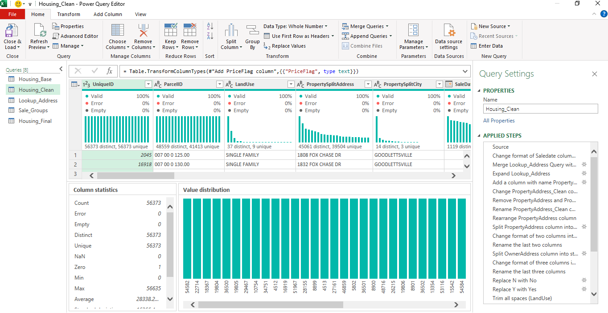
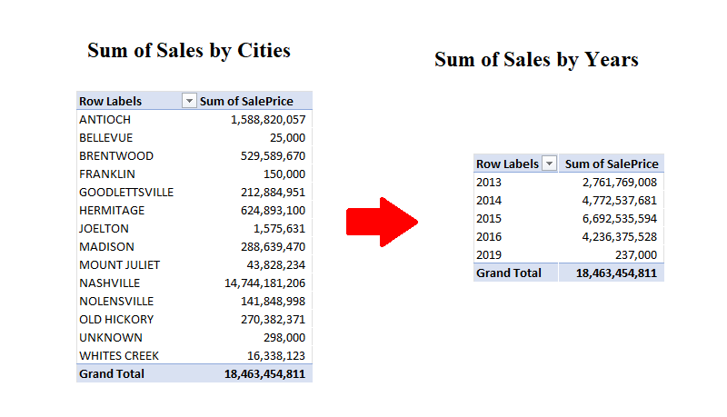
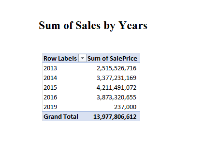

# Nashville Housing: Data Cleaning with Excel & Power Query

A training project that cleans a real-estate sales dataset (56,477 rows, 19 columns) using Excel and Power Query, and documents it the way a freelance client would receive it: a change log, a delivery report, and the Power Query code behind every step.

## Results

| Metric | Value |
|---|---|
| Rows received | 56,477 |
| Rows delivered | 56,373 |
| Rows removed | 104 (103 exact duplicates + 1 conflicting row) |
| Values changed without a documented rule | 0 |

### Key findings

1. **Sales inflated by about 32%.** 1,183 bulk sales appear in 4,767 rows, each carrying the full sale price. Summing `SalePrice` directly gives about 18.46 billion versus an estimated 13.98 billion for the actual transactions. (Estimate: a transaction was identified by `LegalReference`, `SaleDate` and `SalePrice`.)
2. **2,148 rows (3.8%)** where `LandUse` and `SoldAsVacant` conflict. Not corrected, only flagged.
3. **54% of rows** have no owner, acreage or value data. A gap in the source, not a cleaning error.








## What was done

- `SaleDate` converted from date-time to date.
- 29 empty property addresses filled from the same `ParcelID`.
- Addresses split into street, city and state.
- `SoldAsVacant` standardized to Yes/No; vacant-land labels in `LandUse` standardized.
- 103 exact duplicates removed; 1 conflicting row removed (documented as a probable decision, not a confirmed one).
- Added columns: `SaleType`, `RowsInSale`, `QualityNote`, `PriceFlag`.

Everything that was not changed, and why, is listed in the cleaning log.

## Repository structure

```
Nashville-housing-cleaning-by-MMO/
├── README.md
├── LICENSE
├── delivery/
│   ├── Delivery_Report.pdf
│   └── Cleaning_Log.pdf
├── power_query/
│   ├── Housing_Base.pq
│   ├── Lookup_Address.pq
│   ├── Housing_Clean.pq
│   ├── Sale_Groups.pq
│   └── Housing_Final.pq
└── screenshots/
    └── 9 images: Power Query steps, flag columns, pivot checks, notes
```

## How the queries fit together

| Query | Role |
|---|---|
| `Housing_Base` | Reads the source table and sets column types |
| `Lookup_Address` | One address per `ParcelID`, used to fill empty addresses |
| `Housing_Clean` | Date conversion, address fill, splitting, standardization, duplicate removal |
| `Sale_Groups` | Groups rows by transaction to expose bulk sales |
| `Housing_Final` | Merges `Sale_Groups` into `Housing_Clean` and adds the flag columns |

**To reproduce:**

1. Download the source file (link below).
2. In Excel, load it as a table named `Housing_Raw`.
3. Create the queries in the order above and paste each file from `power_query/` into **Home → Advanced Editor**.

## Tools

Excel, Power Query.

## Data source and attribution

The data is the *Nashville Housing Data for Data Cleaning* file published by "Alex The Analyst" in his portfolio-projects repository:
<https://github.com/AlexTheAnalyst/PortfolioProjects>

- The dataset was not created by me. All rights remain with its original publisher.
- That repository's README invites readers to reuse the projects, but it does not state a license or address redistributing the data file. For that reason, **the data file itself is not included here**: download it from the link above and apply the queries in `power_query/`.
- This is a training exercise. It is not client work, and no client data is included.

My own work (report, log, Power Query code) is released under the **MIT License**.

## Contact

Mohanad Mohammed Osman Elawad · [LinkedIn](https://linkedin.com/in/mohanad-osman-147b5b1a1)
Available for data cleaning projects. Contact via LinkedIn.
